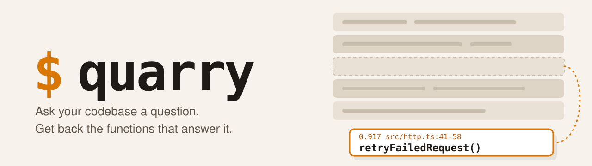

<p align="center">
  <picture>
    <source media="(prefers-color-scheme: dark)" srcset="https://raw.githubusercontent.com/bretperry/code-quarry/dev/assets/banner-dark.svg">
    
  </picture>
</p>

<p align="center">
  <a href="https://www.npmjs.com/package/code-quarry"></a>
  
  
  
  <a href="https://github.com/bretperry/code-quarry/blob/dev/LICENSE"></a>
</p>

Your agent doesn't need to read 40 files to find the retry logic. It needs the retry logic. `quarry` digs it out: plain-English search over every function in your repo, from one 6 MB binary that never touches the network.

- **Saves tokens.** Your agent reads the five functions that matter, not the whole files around them.
- **Nothing to run.** No Docker, no database, no model download, no API key. A search takes about 21 ms.
- **Keeps secrets out of its output.** Detected secrets are cut from everything quarry stores and prints, checked twice.
- **Works with any AI agent.** One command adds the rule to `AGENTS.md`, `CLAUDE.md`, `GEMINI.md`, Cursor, Copilot, Cline, Windsurf, Kiro and Roo rules.

## Dig in

```bash
npm install -g code-quarry                         # prebuilt: macOS/Linux x64+arm64, Windows x64
# or from source: cd rust && cargo install --path .
cd ~/Dev/some-repo
quarry setup                                       # tells your agents about quarry, builds .quarry/index
quarry search "where do we retry failed requests"
quarry search "auth" -k 10 --lines 40              # more results, shorter bodies
```

What comes back, one block per result: score, `path:lines`, name, then the code itself.

```
--- 0.917 scripts/lock.mjs:212-212 stale (function)
const stale = (held, now) => ...
```

## Hand it to your agent

Run `quarry setup` in the repo. It shows what it will write and asks first (`--yes` skips the question).

- **`AGENTS.md`, always.** Codex, Cursor, Copilot, Amp, Zed, OpenCode, Jules and others read it.
- **Each agent's own rules file, when that agent is in use:** `CLAUDE.md`, `GEMINI.md`, `.github/copilot-instructions.md`, `.cursor/rules/`, `.windsurf/rules/`, `.clinerules`, `.kiro/steering/`, `.roo/rules/`.
- **Your existing rules stay.** The quarry rule is added at the end, once. Running setup again changes nothing.

The rule it adds:

> To find where something lives in this repo, run `quarry search "<plain-English question>"` before grepping or reading many files. It returns the top 5 functions with `path:lines` and their code, with detected secrets removed. It re-indexes by itself when files change.

No hooks or MCP server needed: any agent that can run a shell command can use quarry. The index stays fresh on its own. Each search checks file times (milliseconds) and re-indexes when something changed (about a second). In a git repo with no index yet, the first search builds one.

## Secrets: what quarry covers

### What quarry guarantees

- **The index stores no source text.** It holds paths, line numbers, symbol names, hashed keywords, and small vectors. All are made from text after redaction.
- **Redaction runs twice.** Once before indexing, and again on the live file at every search, so an old index can't leak and a secret added after indexing is still caught.
- **It fails closed.** If redaction panics or won't settle, that file is withheld. Non-UTF-8 files, files with NUL bytes, symlinks, paths leading out of the repo, and files over 500 KB are never read. An index from another version or a different redactor is refused.
- **Sensitive files are skipped by path**, at index and at search: `.env*`, `*.env`, `*.pem`, `*.key`, `*.p12`, `*.tfvars`, `*.tfstate`, `id_rsa`, `.npmrc`, `.netrc`, `.ssh/`, `.aws/`, `secrets/`, `keys/`, `private/`, `vault/`, and any filename containing `secret`, `credential`, `password`, `apikey`, or `service-account`. A real code file with such a name, like `secrets_manager.py`, isn't searchable.

<details>
<summary><b>What it detects</b></summary>

About 50 token prefixes (AWS, GitHub, GitLab, Slack, Stripe, OpenAI, Anthropic, Google, npm, PyPI, and others), JWTs, Telegram bot tokens, webhook URLs, private key blocks, passwords and tokens in URLs, `Bearer` and `Basic` values, high-entropy strings, and values assigned to sensitive names (`password`, `token`, `api_key`, and so on). It leans toward over-redacting: about 0.9% of lines across three real repos, mostly test fixtures, config labels, and comments that mention tokens, where it can take the rest of the line.

</details>

### Where its job ends

quarry protects what passes through quarry. An agent that skips quarry and opens files itself (with Read, `cat`, or any shell command) can still see secrets. Blocking that is the job of your agent's permission rules.

- **Other tools are outside it.** To stop an agent opening `.env` directly, deny those paths in its permission rules or hooks.
- **Detection reads shapes, not meaning.** A secret that looks like ordinary code can pass. The cases are listed below.

<details>
<summary><b>What slips past detection</b></summary>

- A short, ordinary string under an ordinary name: `x = "hunter2"`.
- An unquoted word with no digit: `password = hunter`, which reads as a variable.
- A secret split across strings, encoded, or obfuscated.
- A secret in prose: `// the password is hunter2`.
- Short or low-entropy keys of a format it doesn't know.
- A value on a later line of a multi-line call, or a short flag like `-p hunter2`.
- An unquoted value with `.` or `<` in it (`password: gecko.x`), a tuple (`let (user, pw) = ("bob", "x")`), or a non-random secret in a URL path.

</details>

Keep secrets out of source too; quarry is one layer of several.

## Under the hood

<details>
<summary>Chunks, ranking, call links, the model</summary>

- **Chunks:** tree-sitter splits each file by function. py, js, jsx, mjs, cjs, ts, mts, cts, tsx, go, rs, java. Only git-tracked files, or every file in a folder outside git. The comment block directly above a function is indexed with it, so a question can match the comment's words. Comments are read after redaction, feed only the hashed keywords and vectors, and are not printed.
- **Ranking:** two rankers, combined by rank: BM25 keywords on stemmed identifier words (counted 1.5 times as much), and static word vectors weighted by how rare each token is in the repo. Then each function gains half its best caller's score, since the code that calls a function often says what it is for.
- **Call links:** at index time, tree-sitter finds each call and links it to the function of that name: same file first, and skipped when more than 3 functions share the name. The index stores only the links, as chunk numbers. A call on a line that redaction changed is not linked.
- **Model:** 27,628 tokens by 64 dimensions, stored as `i8`, compiled into the binary. Built from `BAAI/bge-small-en-v1.5` (MIT, notice in `rust/model/LICENSE`) by `tools/build_model.py`, with the model2vec recipe. No neural network runs at search time.
- **Search reads the live file**, so code is current. If a file changed since indexing, the function is found again by name. If it's gone, the result says to re-index.
- **Every index build is a full rebuild.** It takes about 1.3 seconds per repo. `search` triggers one when a file it would read is newer than the index, or an indexed file is gone; `--no-refresh` skips that.

</details>

## Small on purpose

<details>
<summary>6 MB and 21 ms, against the old Postgres + ONNX build</summary>

Measured 2026-11-02 on an 8-core Mac, on exports of two real repos (3,648 chunks together).

| | Postgres + ONNX (0.1) | Embedded (0.2) |
|---|---|---|
| Binary | 42.5 MB | 6.1 MB |
| Model | 64 MB, downloaded | inside the binary |
| Database | pgvector in Docker: 656 MB image, 48.6 MB volume | none |
| Index | in Postgres | 397 KB for 1,483 chunks |
| Search, with model load | 230 ms before the database query | 21 ms, whole search |

</details>

## Search quality: the cost of being small

**In short:** on 30 deliberately hard queries, the right function lands in the top 5 about half the time (16 of 30). It's a fast first dig, not an oracle. When the answer isn't there, grep still is.

<details>
<summary>30 hard queries and 728 leak-free ones, with dates</summary>

30 plain-English queries with hand-picked answers, on the same two repos. Deliberately hard: they avoid the words in the code.

| | Right answer in top 5 | Top result right | MRR |
|---|---|---|---|
| bge-small via ONNX (0.1) | 16 of 30 | 6 of 30 | 0.36 |
| Embedded, first release (0.2) | 11 of 30 | 7 of 30 | 0.28 |
| Embedded, comments indexed and ranking tuned | 14 of 30 | 8 of 30 | 0.36 |
| Embedded, plus callers' scores | 16 of 30 | 9 of 30 | 0.39 |

The first two rows were measured on 2026-11-02. The last two were measured on 2026-11-09, after the repos had changed; the first release re-run on that data scores 11 of 30, 8 of 30, 0.31.

A second check uses 728 queries made from the comments above functions in five repos, with each target's comment deleted from the repo first so the index can't have seen it. Adding callers' scores raised the right answer in the top 5 from 56% to 63% on whole comments (431 queries) and from 26% to 33% on comment fragments (297). Callees' scores made results worse. Latent semantic indexing and a learned reranker helped the whole-comment queries but moved the 30 hard queries by one answer at most, so they were left out.

It now matches the neural version's 16 of 30 in the top 5. Indexing the comment above each function and counting keyword matches 1.5 times as much won back 3 answers, and callers' scores 2 more. Larger vectors (256 and 384 dimensions), query expansion, and relevance feedback did not help in tests. Use the code's own terms where you know them, and fall back to grep when results look wrong. One person wrote these queries, and 30 is a small sample: one query is 3.3 points.

</details>
