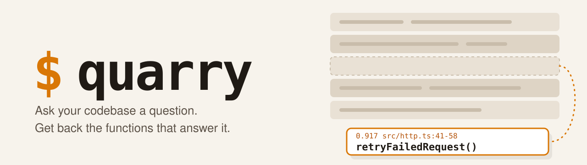

<p align="center">
  <picture>
    <source media="(prefers-color-scheme: dark)" srcset="https://raw.githubusercontent.com/bretperry/code-quarry/dev/assets/banner-dark.svg">
    
  </picture>
</p>

<p align="center">
  <a href="https://www.npmjs.com/package/code-quarry"></a>
  
  
  
  <a href="https://github.com/bretperry/code-quarry/blob/dev/LICENSE"></a>
</p>

Your agent doesn't need to read 40 files to find the retry logic. It needs the retry logic. `quarry` digs it out: plain-English search over every function in your repo, and exact-text search with secrets cut out, from one 7 MB binary that never touches the network.

- **Saves tokens.** Your agent reads the five functions that matter, not the whole files around them.
- **Fast.** A search takes about 30–45 ms, model included. Indexing a whole repo takes about a second.
- **No MCP server, so no context tax.** MCP tools load their definitions into every session, used or not. quarry is a plain command: it costs one short line in your rules file and nothing else until your agent runs it.
- **Nothing to run.** No Docker, no database, no model download, no API key.
- **Keeps secrets out of its output.** Detected secrets are cut from everything quarry stores and prints, checked twice.
- **Works with any AI agent.** One command adds the rule to `AGENTS.md`, `CLAUDE.md`, `GEMINI.md`, Cursor, Copilot, Cline, Windsurf, Kiro and Roo rules.

## Dig in

```bash
npm install -g code-quarry                         # prebuilt: macOS/Linux x64+arm64, Windows x64
# or from source: cd rust && cargo install --path .
cd ~/Dev/some-repo
quarry setup                                       # tells your agents about quarry, builds .quarry/index
quarry search "where do we retry failed requests"
quarry search "auth" -k 10 --lines 40              # more results, shorter bodies
quarry grep -n "STRIPE_KEY" -C1                    # exact text, secrets cut out
```

What comes back, one block per result: score, `path:lines`, name, then the code itself.

```
--- 0.917 scripts/lock.mjs:212-212 stale (function)
const stale = (held, now) => ...
```

## Exact text: `quarry grep`

`quarry search` finds a function by meaning. When you know the exact text, `quarry grep` finds it the way grep does, over the same redacted text `search` prints. A secret's value is not in that text, so no flag, count, or exit code can find it.

```
$ quarry grep -n "STRIPE_KEY" -C1
src/pay.ts-11-const client = new Stripe(
src/pay.ts:12:  process.env.STRIPE_KEY ?? "[REDACTED]",
src/pay.ts-13-);
quarry: withheld 1 file (sensitive: .env.local)
quarry: 2 files had redactions; matches inside them can't show
```

```
quarry grep [flags] <pattern> [path...]
  -F fixed  -i ignore case  -w word  -A/-B/-C <n>  -l files only  -c counts  -m <n> max per file
  -g <glob> (repeatable; !glob excludes)  --no-ignore  --repo <dir>
  exit 0 match · 1 no match · 2 error
```

- **No index needed.** It reads the live files, so it is never stale. In a git repo it searches tracked and unignored files; `--no-ignore` searches every file under the target, and a file named on the command line is searched even if git ignores it or it sits in a dot folder. Sensitive-file rules still apply to it. Outside git it walks the folder and skips folders that start with a dot. `.git` is never searched.
- **Matching runs on redacted text only.** Every file goes through the same reader `search` uses: sensitive paths, symlinks, and binary files are not read, and a file whose redaction fails is withheld. Files over 500 KB or not in UTF-8 are skipped, and stderr names them. There is no match on raw text first, so `-l`, `-c`, and the exit code tell nothing about a secret. Like ripgrep, `-c` lists only files with a match.
- **Patterns are Rust regex syntax.** It runs in linear time. Lookaround and backreferences are errors (exit 2), and `-P` is refused. Use `-F` for plain text. A pattern matches within one line.
- **Redaction can hide a match.** A line with a token, a hash, or a `password = ...` value shows `[REDACTED]` in its place, so grepping for the hidden part finds nothing. stderr counts the files that had redactions. The count does not depend on your pattern.
- **Output is capped** at 20,000 characters, and lines at 300. When it is cut, the last line says how many matches were left out. Narrow the pattern, or add `-g`.
- **Fast:** `quarry grep TODO` on axios (533 files) takes 160–230 ms on a 4-core machine, redaction included, and runs on every core it has.

`quarry sensitive-list --json` prints the short list of files that tools should never open raw, as `{dirs, names, extensions, exempt_suffixes}`. A `names` entry ending in `*` means "starts with" (`.env*`), and a name ending in an `exempt_suffixes` entry (`.env.example`) is not on the list. `quarry env-keys <file>` prints a `.env` file's key names, one per line, and never a value.

## Hand it to your agent

Run `quarry setup` in the repo. It shows what it will write and asks first (`--yes` skips the question).

- **`AGENTS.md`, always.** Codex, Cursor, Copilot, Amp, Zed, OpenCode, Jules and others read it.
- **Each agent's own rules file, when that agent is in use:** `CLAUDE.md`, `GEMINI.md`, `.github/copilot-instructions.md`, `.cursor/rules/`, `.windsurf/rules/`, `.clinerules`, `.kiro/steering/`, `.roo/rules/`.
- **Your existing rules stay.** The quarry rule is added at the end, once. Running setup again changes nothing.

The rule it adds:

> To find where something lives in this repo, run `quarry search "<plain-English question>"` before grepping or reading many files. It returns the top 5 functions with `path:lines` and their code, with detected secrets removed. It re-indexes by itself when files change. For exact text, run `quarry grep -n "<text>" [path]` instead of grep: it prints the same matching lines with secrets removed.

No hooks or MCP server needed: any agent that can run a shell command can use quarry. The index stays fresh on its own. Each search checks file times (milliseconds) and re-indexes when something changed (about a second). In a git repo with no index yet, the first search builds one.

## Secrets: what quarry covers

### What quarry guarantees

- **The index stores no source text.** It holds paths, line numbers, symbol names, hashed keywords, and small vectors. All are made from text after redaction.
- **`quarry grep` can't read a secret back.** It matches only on redacted text, so grepping for a secret's value finds nothing, in any mode.
- **Redaction runs twice.** Once before indexing, and again on the live file at every search, so an old index can't leak and a secret added after indexing is still caught.
- **It fails closed.** If redaction panics or won't settle, that file is withheld. Non-UTF-8 files, files with NUL bytes, symlinks, paths leading out of the repo, and files over 500 KB are never read. An index from another version or a different redactor is refused.
- **Sensitive files are skipped by path**, at index and at search: `.env*`, `*.env`, `*.env.*`, `env`, `env.*` (but not code like `env.ts`), `*-env`, `.dev.vars`, `*.pem`, `*.key`, `*.p12`, `*.tfvars`, `*.tfvars.json`, `*.tfstate`, `id_rsa` and names containing it, `.npmrc`, `.netrc`, `.my.cnf`, `.s3cfg`, `.boto`, `.vault-token`, `kubeconfig`, `.ssh/`, `.aws/`, `secrets/`, `keys/`, `private/`, `vault/`, and any filename containing `secret`, `credential`, `password`, `apikey`, or `service-account`. A backup of any of these (`.bak`, `.old`, `.orig`, `.save`, `.swp`, `~`) is skipped too, while `.env` templates (`.example`, `.sample`, `.template`) are read. Files under `.ssh`, `.aws`, `.gnupg`, `.kube`, `.docker`, `.azure`, `.gcloud`, `.config/gcloud`, or `.secrets` are skipped wherever the search starts, even when it starts inside one. A real code file with a sensitive name, like `secrets_manager.py`, isn't searchable.

<details>
<summary><b>What it detects</b></summary>

About 50 token prefixes (AWS, GitHub, GitLab, Slack, Stripe, OpenAI, Anthropic, Google, npm, PyPI, and others), JWTs, Telegram bot tokens, webhook URLs, private key blocks, passwords and tokens in URLs, `Bearer` and `Basic` values, high-entropy strings, and values assigned to sensitive names (`password`, `token`, `api_key`, and so on).

It also reads the config shapes secrets live in:
- YAML values under a secret-named key, including `|` blocks, lists and nested blocks under `secrets:`
- every value in a Kubernetes `kind: Secret`
- `[secrets]` tables in TOML and INI
- JSON objects under `"secrets"` or `"credentials"`
- XML `<password>` elements and name/value pairs
- container env entries (`- name: DB_PASSWORD` / `value:`)
- Terraform variables with a secret name
- `.env` values, including Dockerfile `ENV`
- connection strings (`Password=x;`)
- SQL `PASSWORD '...'` and `IDENTIFIED BY '...'`
- netrc lines

It errs on the side of hiding: across six public repos, about 0.8% of lines show a `[REDACTED]`, mostly lockfile hashes and test fixtures.

</details>

### Pair it with your agent's permissions

quarry keeps secrets out of everything that passes through quarry. Pair it with your agent's permission rules, which govern the files it opens itself: deny `.env` and key files there, and point the agent at quarry for search. `quarry sensitive-list --json` gives those rules a ready-made list.

Detection reads shapes, so a secret written to look like ordinary code can pass. The details are below.

<details>
<summary><b>Shapes quarry leaves as they are</b></summary>

- A short, ordinary string under an ordinary name: `x = "hunter2"`.
- A key name outside the secret-name list: `mfa_seed`, `webhook_url`, `connstr`, and config words like Redis's `requirepass` and `masterauth`.
- An unquoted single word with no digit after `=`: `password = hunter`, which reads as a variable. (`password: hunter` at the start of a YAML line is redacted.)
- In a YAML-looking line, a capitalized word with no digit (`password: Summer`), which reads as a type like `SecretStr`.
- A secret split across strings, encoded, or obfuscated.
- A secret in prose: `// the password is hunter2`.
- Short or low-entropy keys of a format it doesn't know.
- A value on a later line of a multi-line call or a typed assignment (`const TOKEN: &str =` with `"x";` on the next line), or a short flag like `-p hunter2`. An untyped `password =` with the quoted value on the next line is caught.
- Multi-line dict and map literals in code (`creds = {\n  "pw": "x"\n}`); objects are followed only under a quoted `"secrets"` or `"credentials"` key.
- An unquoted value with `.` or `<` in it after `=` (`password = gecko.x`), a tuple (`let (user, pw) = ("bob", "x")`), or a non-random secret in a URL path.
- Ruby `%q(...)` strings and heredoc values.
- Fullwidth punctuation as the operator: `password＝x`, `password：x`.
- Generic folder names (`secrets/`, `private/`, `keys/`, `vault/`, `credentials/`) are skipped inside a repo, but not when the search itself starts inside one, since whole projects live under such names.
- A hardlink to a sensitive file under an ordinary name.
- Inside a string, a value runs to the closing quote or the first `;`, so a secret containing `;` (`"Password=ab;cd"`) shows its part after the `;`.
- Under a secret-named YAML key (`secrets:`), a child value that is prose, a path, a slug like `my-db`, a number, or a template, or that sits under a schema key such as `type`, `description` or `enabled`, is shown. Translated text under such keys is shown too.
- The Arabic letter mark (U+061C) in a file name is printed as is; other direction marks are escaped.
- A key that names a Kubernetes Secret rather than holding one is never redacted: names starting with `existing` (`existingSecret`) or containing `pull` (`imagePullSecrets`).
- Under a secret-named YAML key, `key:` with a value of only lowercase letters (`key: token`) reads as a field name in a Kubernetes Secret reference and is shown; one with a digit, capital or symbol is hidden.
- A netrc line inside a shell string (`echo 'machine h login u password x' >> ~/.netrc`) shows its password; netrc lines are recognized only at the start of a line.
- Ansible Vault ciphertext (`!vault |` followed by `$ANSIBLE_VAULT;...`) is shown; it is encrypted, not a plaintext secret.
- A `|` block under a key that isn't on the secret-name list (`ssh_key: |`) is shown, while `api_key: |` is hidden whole. A private key inside either is still hidden by its `-----BEGIN ... PRIVATE KEY-----` shape.
- A translated label without sentence punctuation under a key ending in `credential(s)` or `password` (`webauthn_credentials: Credenciales WebAuthn`) may be hidden.
- Files with NUL bytes, and UTF-16 without a byte-order mark or mostly non-ASCII text, are skipped without a note; `quarry grep` names only files over 500 KB or not UTF-8 that it can recognize.

</details>

Secrets belong in a secret manager; quarry keeps the ones that slip into source out of your agent's context.

## Under the hood

<details>
<summary>Chunks, ranking, call links, the index</summary>

- **Chunks:** tree-sitter splits each file by function. py, js, jsx, mjs, cjs, ts, mts, cts, tsx, go, rs, java. Git-tracked files in a repo, or every file in a folder outside git. The comment block directly above a function is indexed with it, so a question can match the comment's words. Comments are read after redaction, feed only the hashed keywords and vectors, and are not printed.
- **Ranking:** two rankers, combined by rank: BM25 keywords on stemmed identifier words (counted 1.5 times as much), and word vectors weighted by how rare each token is in the repo. Then each function gains half its best caller's score, since the code that calls a function often says what it is for.
- **Call links:** at index time, tree-sitter finds each call and links it to the function of that name: same file first, and skipped when more than 3 functions share the name. The index stores only the links, as chunk numbers. A call on a line that redaction changed is not linked.
- **Word vectors:** 27,628 tokens by 64 dimensions, stored as `i8` and compiled into the binary (MIT, notice in `rust/model/LICENSE`). Nothing to download, nothing to run beside it.
- **Search reads the live file**, so code is always current. If a file changed since indexing, the function is found again by name.
- **Indexing is a full rebuild** and takes about a second per repo. `search` triggers one when a file it would read is newer than the index, or an indexed file is gone; `--no-refresh` skips that.

</details>

## Search quality

On 30 deliberately hard plain-English queries, written to avoid the words in the code, the right function is in the top 5 for 16 and ranked first for 9. On 728 queries made from the comments above functions in five repos, with each target's comment removed first so the index can't have seen it, the right function is in the top 5 for 63% of whole comments and 33% of short comment fragments.

Use the code's own words when you know them; they count the most. For exact text, `quarry grep` finds it with secrets cut out.
